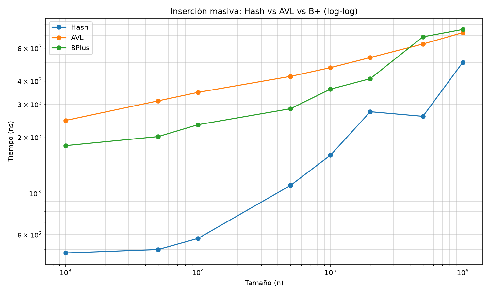
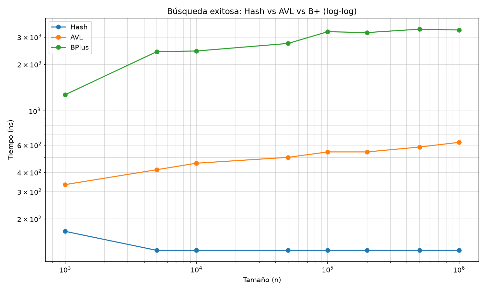
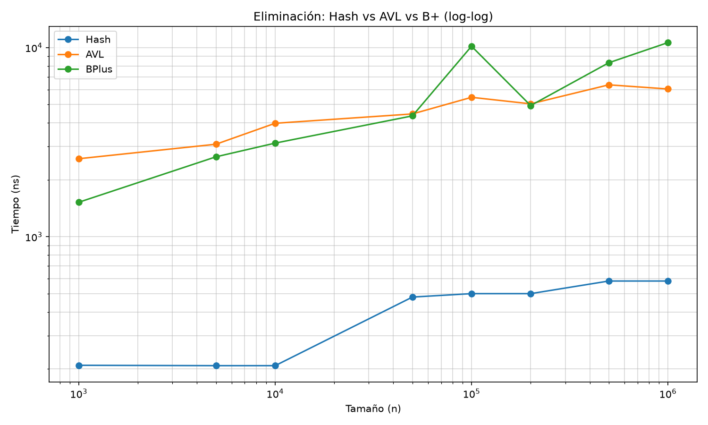
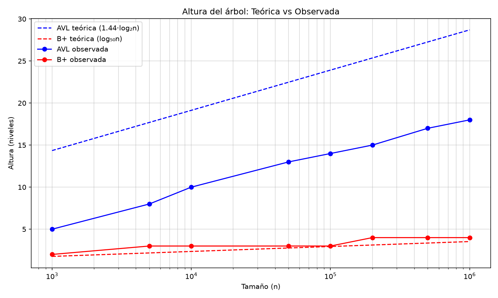
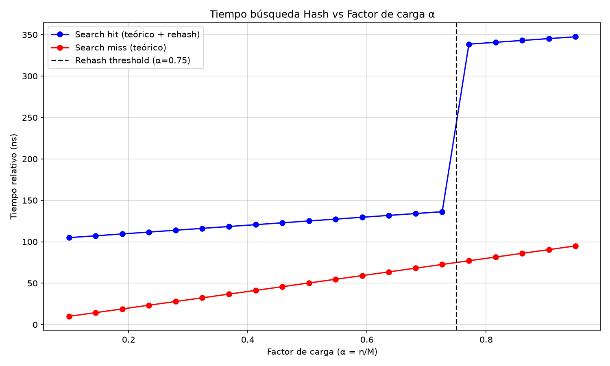
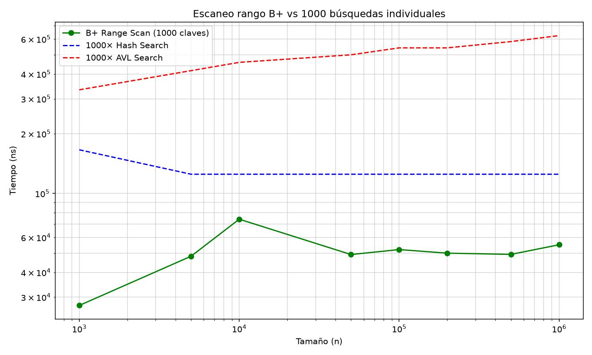

# Bitácora 2: Estructuras de Búsqueda

Repositorio para el análisis de Tabla Hash, Árboles AVL y Árboles B+.

## Requisitos
- Python 3.15+
- Dependencias: `pip install -r requirements.txt`

## Ejecución
1. Generar datos y mediciones:
   `python3 pruebas_estructuras.py`
2. Generar análisis y gráficas:
   `python3 analisis_graficas_estructuras.py`

## Control de Semillas
- Se utiliza `random.seed(42)` en `pruebas_estructuras.py` para garantizar reproducibilidad.

## Resultados Visuales

### Inserción Comparativa

### Búsqueda Exitosa Comparativa

### Eliminación Comparativa

### Altura AVL vs B+

### Factor de Carga Hash

### Escaneo de Rango (B+)

